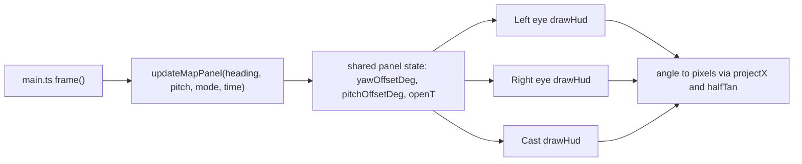

# Full-screen see-through glass map

## Current behavior

- In Cardboard, expanded mode draws a head-locked square panel ([web/src/floating-map.ts](web/src/floating-map.ts)) capped at 86% of eye width and 62% of height. Roads are drawn at 45% opacity and transit overlays at full opacity. It has no open or close animation.
- In the handheld view, expanded mode draws an opaque square from the composite canvas ([web/src/hud.ts](web/src/hud.ts) `drawStreetMap`).
- The map buffer in [web/src/street-map.ts](web/src/street-map.ts) is a fixed 512 px square with the user at `(256, 256)`.

## Target experience

- **Size:** "Expand the map" opens a glass panel that fills almost the entire eye in Cardboard, or the full screen on the phone, with small margins and large rounded corners.
- **Layering:** The compass, gaze status, summary line and subtitles stay head-locked and draw on top of the glass. The compass stays at the top, as required.
- **See-through:** A very faint tint, a thin bright rim with a top highlight, roads at about 30% opacity, and full-opacity routes, stops, buses and the user marker, so the street stays visible behind the map. There is no blur, because blur would impair vision.
- **Opening (visionOS-style):** The panel scales from 0.92 to 1, fades in and rises slightly, over about 350 ms with an ease-out curve. Closing reverses this over about 220 ms, then the compact minimap returns. Reduced-motion preferences skip the animation.
- **Lazy follow:** When the panel opens, it is anchored to the current heading and pitch. Small head movements (within about 10 degrees of yaw or 8 degrees of pitch) leave it in place in the world, so it shifts naturally in view. Beyond that, the anchor glides back toward center, using critically damped smoothing with a time constant of about 250 ms. It settles once within about 2 degrees, so it does not jitter. When there is no heading, such as on desktop without dev heading, the panel is head-locked.

## Changes

1. **New `web/src/map-panel.ts`** (pure and testable):
   - `createMapPanel()` and `updateMapPanel(panel, { mode, headingDeg, pitchDeg, timeMs, reducedMotion })` return `{ visible, openT, yawOffsetDeg, pitchOffsetDeg }`.
   - It uses `signedDiffDeg` from [web/src/geo.ts](web/src/geo.ts) so wraparound at 359 and 1 degrees works.
   - It handles reopening during the close animation and closing during the open animation without jumps.
   - `mapPanelRect(w, h, halfTan, panelFrame)` converts the angular offset to pixels with the existing pinhole projection. Horizontal shift is `tan(offset) / halfTan`. Vertical shift uses the vertical half-tangent `halfTan * h / w`. It also applies the scale and rise from `openT`.
2. **[web/src/main.ts](web/src/main.ts) `frame()`:**
   - Call `updateMapPanel` once per frame, using `orientation.get()?.pitchDeg`, or 0 in dev.
   - Pass the result as `HudState.mapPanel`, so both eyes and the cast frame get identical angular state and each converts it with its own `halfTan`.
   - Keep `expandedMap` true while the close animation runs.
   - Tell the street map the expanded panel aspect, taken from the eye size.
3. **[web/src/street-map.ts](web/src/street-map.ts) rectangular buffer:**
   - Replace the fixed `SIZE` and the hard-coded `256` center with a width and height matching the panel aspect. The short side stays 512 CSS px and the long side is capped at 2:1. The user is at the buffer center.
   - Define `extentKm` as the distance from center to the edge of the short side, so the range label keeps its meaning.
   - Update `mapZoom` and `mapPoint` in [web/src/map-state.ts](web/src/map-state.ts) to take the short side.
   - The compact minimap crops the center square of the same buffer. Switching modes then never re-renders or distorts the buffer, and the close animation stays continuous.
   - The cast frame uses a cover-crop when its aspect differs.
4. **[web/src/hud.ts](web/src/hud.ts) and [web/src/floating-map.ts](web/src/floating-map.ts):**
   - Replace `floatingMapBounds` with full-screen glass bounds: about 4% margins in Cardboard, inside the lens-visible area, and safe-area margins on the phone.
   - Add `drawGlassPanel`, which draws the tint, rim and highlight, clips to the rounded rectangle, draws roads at reduced opacity and then transit overlays at full opacity, under `globalAlpha = openT`.
   - Use the same panel for the handheld view (`!s.handheld` is no longer a condition), keeping the DOM `.map-controls` (close, zoom in and zoom out) above it.
   - Move the range chip, the radar or road-failure notice and the attribution inside the glass edges.
   - Keep `drawFloatingSummary`, subtitles and "STOP BEARING · NOT A WALKING PATH" head-locked over the glass.
5. **[web/src/style.css](web/src/style.css):** Restyle the handheld `.map-controls.is-expanded` as translucent glass buttons that stay legible over the see-through map.
6. **Docs:** Update [docs/CARDBOARD_HUD.md](docs/CARDBOARD_HUD.md). It currently says the panel is "a flat panel without world anchoring", 86%/62% in size, with a 45% base. Describe the full-screen glass panel, the lazy follow and the animation, and note that device acceptance is still pending. Add a brief note in [README.md](README.md) if it describes the expanded map.

## Tests (`web/tests/`)

- **New `map-panel.test.ts`:**
  - The deadzone holds the anchor.
  - Exceeding the deadzone recenters it smoothly and it settles.
  - Wraparound near north works.
  - A null heading is head-locked.
  - Open and close `openT` timing is correct, including reversal partway through.
  - Reduced motion is instant.
- **Update `floating-map.test.ts`:**
  - Full-screen bounds hold for portrait, landscape and cast sizes.
  - Both eyes get identical draws for the same panel state.
  - Layer opacities are correct.
  - Overlays stay full opacity.
  - Long replies do not move the panel.
  - The phone also gets the glass panel.
- **Update `map.test.ts`:** The rectangular buffer projection is correct, and the compact center-square crop keeps the same extent.

## Verification

- Run `npm test` and `npm run build` in `web/`. Check Android imports of the changed `map-state` exports, and run the Android web build if the toolchain is available.
- On desktop, open `http://localhost:5173/?dev=1&data=fixture` in Cardboard and handheld views, then:
  - Open the map with voice text and with the keyboard (`m`).
  - Capture screenshots during the open animation, at rest, after a small turn (the panel shifts) and after a large turn (it glides back). Check for compass wraparound.
  - Confirm both eyes match.
  - Close the map with Escape and with "close the map", and confirm the selection and guidance are kept.
- Record physical headset comfort, outdoor see-through readability and real pitch behavior as pending.